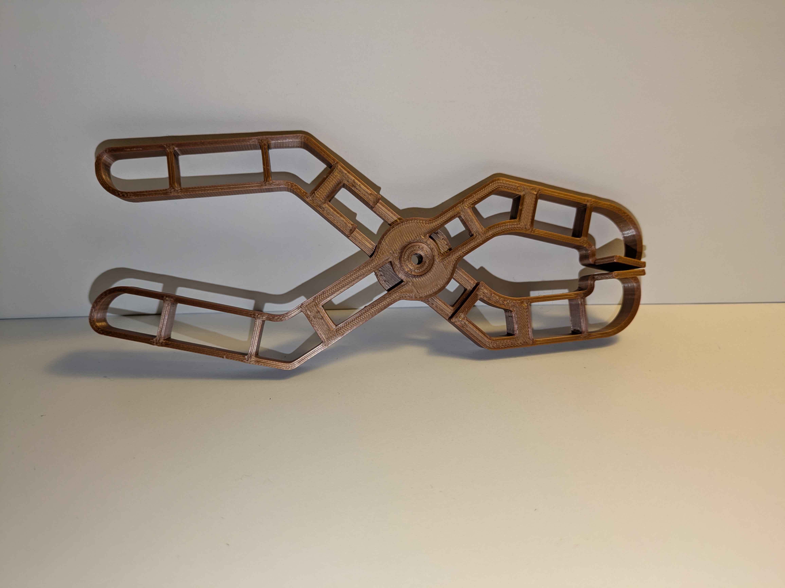
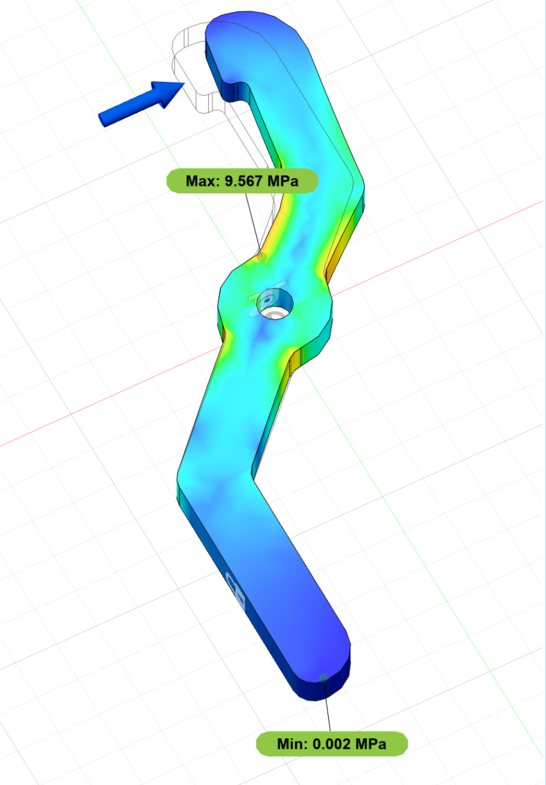
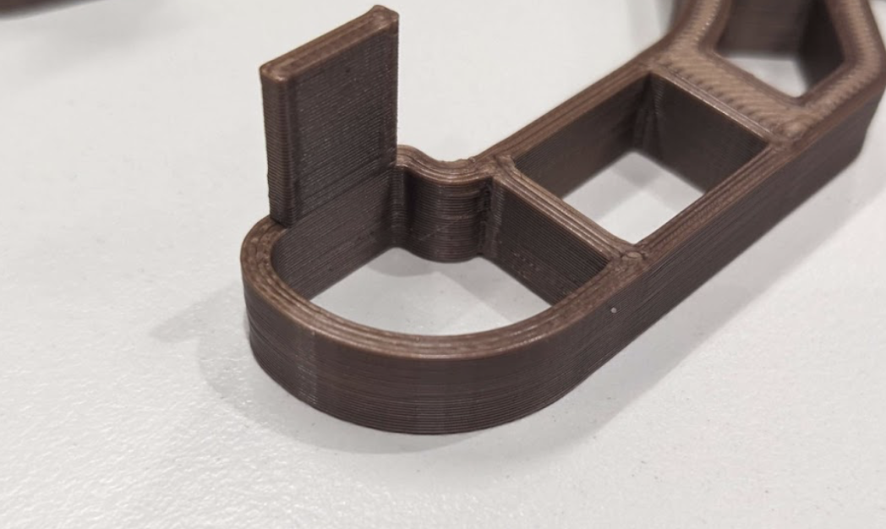
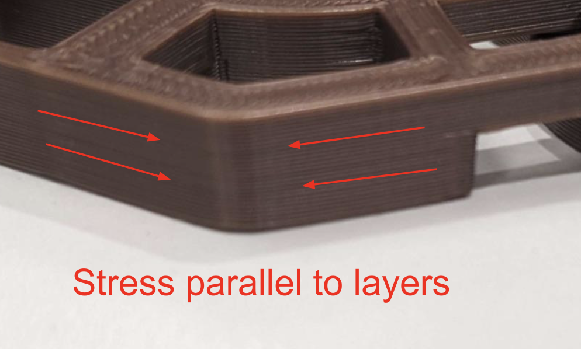
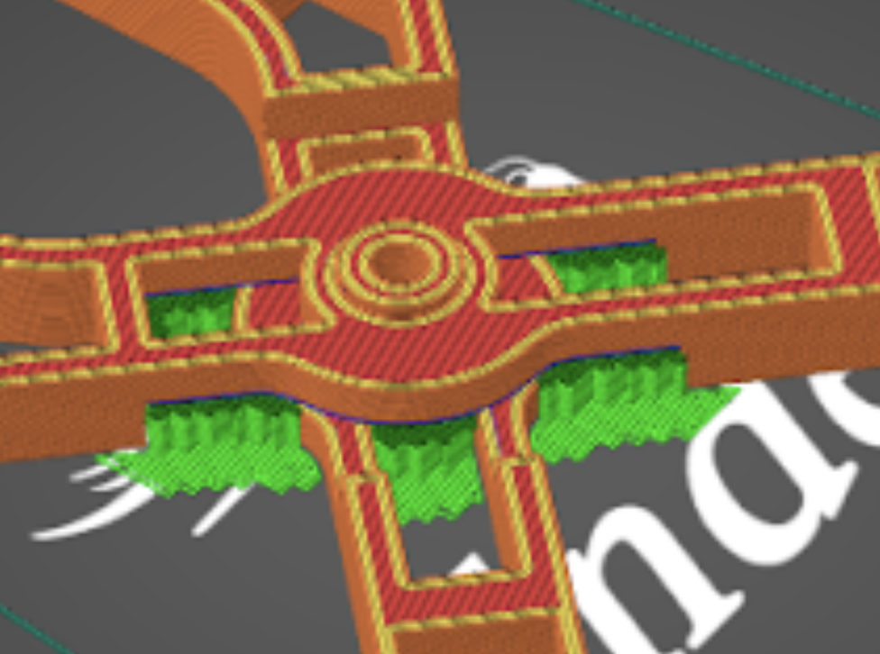

University Project

<h2>Summary</h2>

I designed a pair of 3D-printed pliers that are monolithic (printable in one piece with minimal post-processing). My design weighs under 20 g but can apply over 4 kg of clamping force before breaking.

<h2>Skills Used</h2>
<ul>
    <li>CAD (Autodesk Fusion)</li>
    <li>Design for Additive Manufacturing</li>
    <li>Finite Element Analysis</li>
    <li>3D Printing</li>
</ul>

<!--more-->

    

        <h2>Acknowledgements</h2>
        
Thank you to Guy Smith for slicing and 3D printing the model, as well as for helping me with content understanding throughout the subject. Thank you to the subject staff and friends as well for their support.

    

    

        
        
Monolithic Pliers

    

    

        <h2>Finite Element Analysis</h2>
        
Mechanical property simulations were used to maximise part strength whilst minimising material usage. The design experiences the most stress near the hinge so I accumulated the most material around that section. The handles and jaws received much less stress, so I reduced the mass significantly in those areas.

    

    

        
        
Finite Element Analysis

    

    

        
        
Pliers' Jaw

        
        
Stress Orientation

    

    

        <h2>Strength Considerations</h2>
        
Many curves and fillets were used in the design. This not only aids in the ergonomics of the pliers but also allows for a more even distribution of stress, which tends to accumulate at sharp edges.

        
The thickness of the truss beams was made to be an integer multiple of the 3d printer's wall thickness, optimising the strength and material usage in the design.

        
The pliers were designed to be printed in an orientation such that the strength of the parts during their function would not be hindered by anisotropy. Fused deposition modelling (FDM) parts are particularly susceptible to breaking, or delamination, when they experience forces that separate the layers. The forces applied to the handles and jaws, as well as the tension inside them, will be parallel to the layers, so there will not be tension pulling the layers apart. There will be no shear forces parallel to the layers outside of the hinge, which is the thickest part of the pliers to counteract this weakness.

    

    

        <h2>Post-Processing Considerations</h2>
        
No brims or rafts were necessary for the design, except for the required supports. The pliers have a large flat surface at the bottom, making extra adhesion material unnecessary. This decreases material waste, post-production time and the risk of damaging the print during post-production.

        
The part has been designed to make minimal use of supports, containing no overhangs outside the section where the two parts meet at the hinge. The hinge itself is sealed with a 40&deg slope, an overhang that is printable without supports. This minimises waste material, post-processing time and the risk of damaging the part during post-processing.

    

    

        
        
Pliers' Hinge in PrusaSlicer

    

