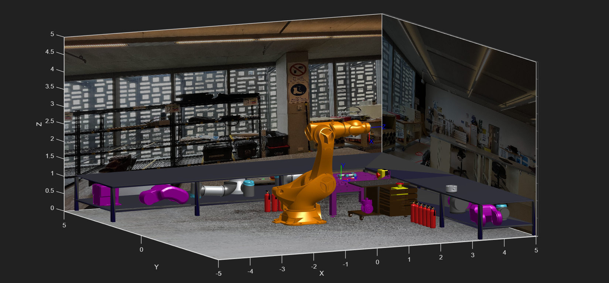
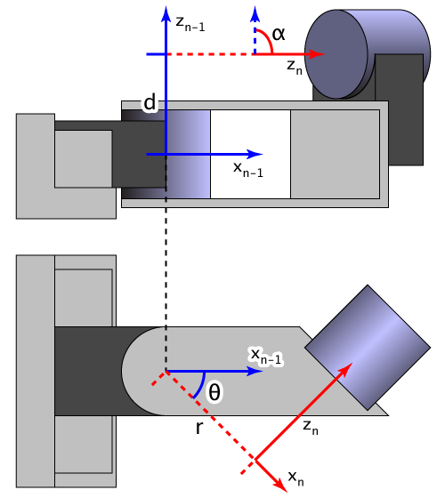
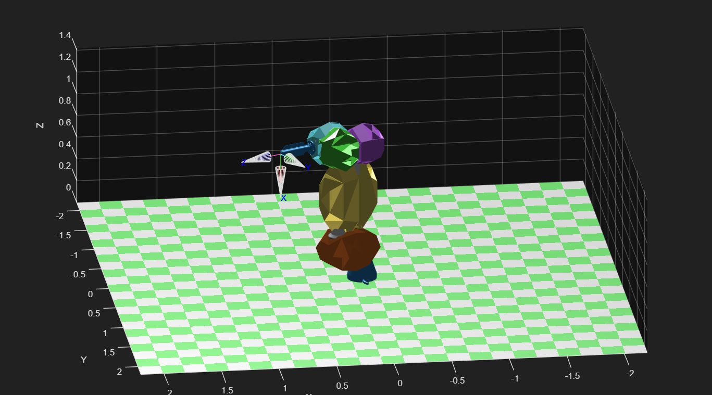
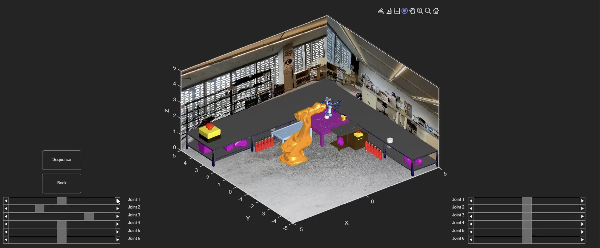
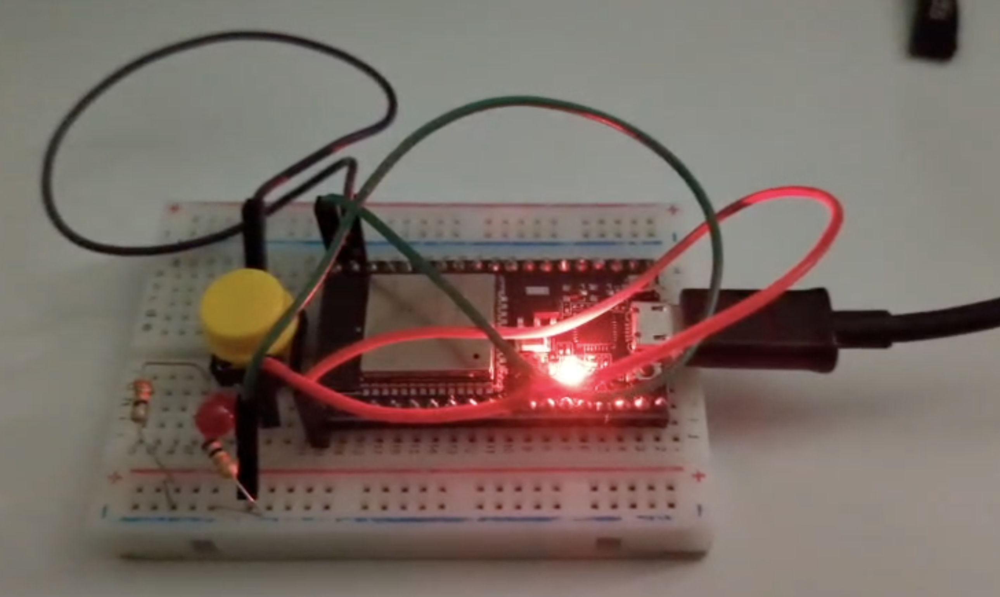

University Group Project with <a href="https://www.linkedin.com/in/john-a-chen/">John Chen</a> and Guy Smith

<h2>Summary</h2>

We designed a simulation of an automated robotic welding setup. Two 6-DOF (6 degrees of freedom) robotic arms can be programmed to manipulate heavy metal parts and apply welds to them. This system accounts for many safety features such as obstacle avoidance, singularity avoidance and emergency stopping.

<h2>Skills Used</h2>
<ul>
    <li>CAD (SOLIDWORKS and Blender)</li>
    <li>MATLAB</li>
    <li>Programming 6-DOF Robotic Arms</li>
    <li>Linear Algebra</li>
</ul>

<!--more-->

    

        <h2>Acknowledgements</h2>
        
Thank you to my team members John Chen and Guy Smith for enabling a supporting, productive work environment, as well as contributing excellent work. Thank you to the subject staff and friends as well for their support.

        <h2>Context</h2>
        
Robotic and automated welding is one of the most significant and impactful developments in manufacturing technology. A fully automated welding process can prevent people from being exposed to safety risks such as burns, electrocution, blinding and the inhalation of toxic fumes. Moreover, utilising robots in the welding process can result in higher accuracy, reproducibility and speed. Utilising heavy-duty robotic arms grants manufacturers the ability to manipulate heavy parts during the welding process. 

        
In this project, we have designed a system to realise the capability, precision and human safety granted by robotic welding opportunities. Our system utilises the Universal Robots UR3e as the robotic arm that manipulates the torch. The system also includes a Kuka KR1000, a heavy-duty robotic arm whose maximum payload of 1.3 T makes it highly capable of manipulating heavy pieces.

    

    

        
        
System Simulation

    

    

        <h2>Forward Kinematics</h2>
        
In the context of a robot arm, forward kinematics is the process of finding the position and rotation of the end effector (essentially the hand of the robot) given the angles of all of its joints. The system simulation includes an option to individually control each joint of each robotic arm, and forward kinematics is used to resolve the position of the end effector. 

        
These robotic arms form kinematic chains, where each joint can have its own defined reference frame relative to the one before it (almost always consisting of simple translations and rotations). A common convention to define these reference frames is Denavit–Hartenberg (DH) parameters. By defining the DH parameters of the two robot arms, forward kinematics can be achieved by propagating through the relative reference frames.

        <h2>Inverse Kinematics</h2>
        
Inverse kinematics is the reverse process of forward kinematics, finding the joint angles for a given end effector position and rotation. One of the main functionalities of the system simulation is the ability to program paths for the end effector to follow. Inverse kinematics is used to find the joint angles at the start of the path, and sometimes at the end. However, it is not advisable to use inverse kinematics for the whole path because most calculating methods can be slow and inconsistent.

    

    

        
        
DH Parameters Diagram (Tira-Thompson, 2009)

    

    

        
        
Robot Self-Collision Detection

    

    

        <h2>Path Planning</h2>
        
The motion of the robot arm throughout the path can be efficiently controlled with resolved motion rate control (RMRC). This technique uses the Jacobian of the robot, essentially a large matrix of derivatives that describes how the end effector position would change for a given joint angle configuration and change. By inverting the matrix, we can calculate the joint angle velocities necessary to achieve a certain end effector velocity. This is a fast and efficient way of controlling the motion of the end effector through a path, while also granting the programmer precise knowledge and control to constrain joint velocities to safe levels.

        
There are regions within the reach of a robot where a small end effector velocity step can lead to an unruly joint jolt. These are called singularities, and can be detected by measuring the rank or determinant of the Jacobian. An amendment can be made to RMRC so that the end effector can avoid singularities. This is called Least Damped Squares (LDS) and it involves a damping factor which manipulates the inverse Jacobian to guide the end effector away from singularities.

        
The system simulation also includes collision detection and obstacle avoidance. Regions near the robots that should not be interfered with can be placed inside an obstacle volume, which will influence the generated path outwards.

    

    

        <h2>User Interfaces</h2>
        
The software simulation includes a graphical user interface which allows the user to control every joint, plan straight-line paths, and immediately stop the robot's motion with an emergency stop button. The system also supports a physical emergency stop button (implemented with a microcontroller). The user can control the robots' end effectors with a game controller. 

        <h2>Safety</h2>
        
Collision detection and avoidance is implemented so that the robots do not collide with themselves, each other, or key elements of the environment. The digital and physical emergency stop buttons ensure that the robots' operation completely and immediately ceases in the event of an emergency. The simulated environment includes safety equipment such as fire extinguishers and fencing.

    

    

        
        
Graphical User Interface

    

    

        
        
Physical E-Stop

    

<h2>References</h2>

Corke, P. (2017). <em>Robotics Toolbox</em>. Peter Corke. https://petercorke.com/toolboxes/robotics-toolbox/

Tira-Thompson, E. (2009). <em>Illustrates the transformation parameters of a pair of reference frames laid out according to Denavit-Hartenberg convention</em> [Image]. Wikimedia Commons. https://commons.wikimedia.org/wiki/File:Sample_Denavit-Hartenberg_Diagram.png

