

    

        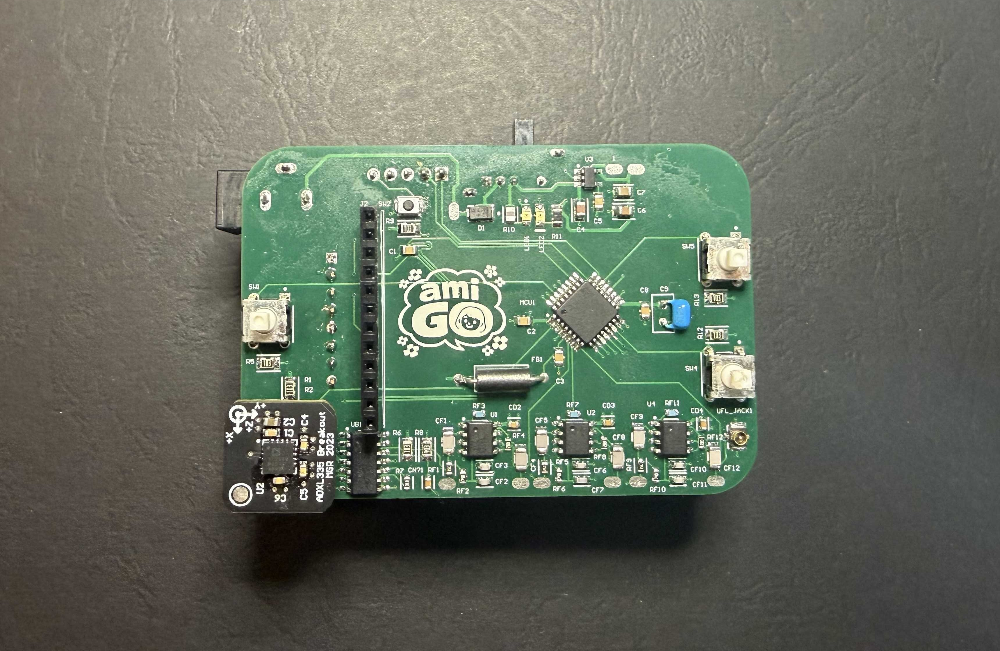
        
PCB layout (credit to Isabelle)

    

    

        <h2>Acknowledgements</h2>
        
Thank you to my amazing team (Isabelle Tia, Daniya Syed and Zain Khan) during this project, all of whom were very supportive, as well as achieving excellent work. To give you a brief, inconclusive snapshot of their work that will hopefully help you understand their brilliance:

        <ul>
            <li>Isabelle brilliantly organised the system peripherals, created a perfect PCB layout, soldered three devices and contributed greatly to system testing</li>
            <li>Daniya masterfully integrated the STM32F303K8 MCU chip onto the board and programmed a very nice user interface</li>
            <li>Zain designed a perfect system to distribute power to all peripherals, as well as a beautiful outer shell for the device</li>
        </ul>
        
Thank you to the subject teaching staff (Dr Quan Nguyen, Dr Chunyue (Mevis) Li, Nicholas Sabatta, Sebastian Baudille, Jayden Hazell and Marcin Ko&nacute;czyk) for their consistent support and encouragement during the project.

        
Thank you to my friends and family for their support during my partaking in the project.

    

    

        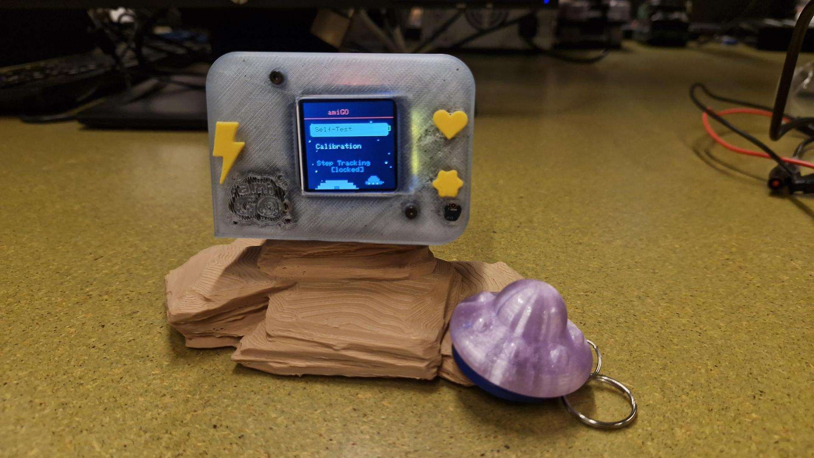
        
Ami-GO device

    

<h2>Filter Design</h2>

    

        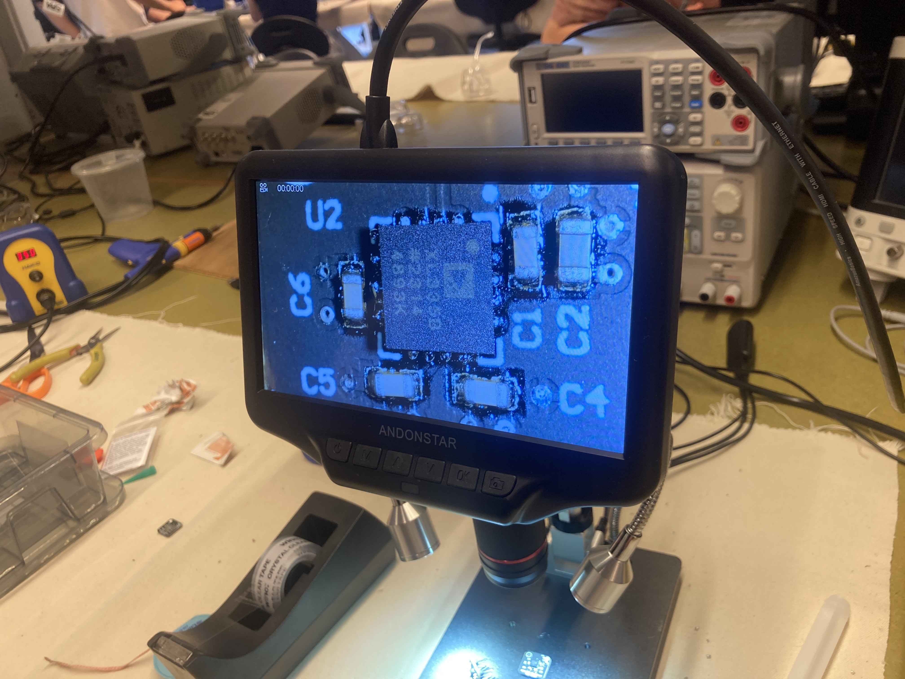
        
ADXL335 under microscope

    

    

        <h3>Objective</h3>
        
The step counter uses an ADXL335 3-axis accelerometer with analog signals to measure the user&apos;s motion and count steps. The signals are prone to high-frequency noise.

        
The design considerations for the analog filter include:

        <ul>
            <li>Frequencies to keep or discard</li>
            <li>Cutoff frequency</li>
            <li>Filter topology</li>
            <li>Response type</li>
            <li>Filter order</li>
            <li>Filter gain</li>
            <li>Active vs passive filtering</li>
            <li>Component selection</li>
        </ul>
    

    

        <h3>Types of Frequency Filters</h3>
        
There are different filter types depending on what types of frequencies that one would want to keep, and which to discard:

        <ul>
            <li><strong>Low-pass filters</strong> let low frequencies through and discard high frequencies</li>
            <li><strong>High-pass filters</strong> do the opposite of low-pass filters</li>
            <li><strong>Band-pass filters</strong> only let frequencies through if they are within a certain frequency band</li>
            <li><strong>Band-stop filters</strong> are the opposite of band-pass filters. They only stop frequencies if they are within a certain frequency band</li>
            <li><strong>Notch filters</strong> let all frequencies through except for one very specific one. They can be thought of as a specific type of band-stop filter</li>
        </ul>
        
A low-pass filter was chosen to condition the analog signal because it was identified that the most significant detriment to the accuracy of the unfiltered accelerometer signal was noise in high frequencies (approximately greater than 100 Hz). Meanwhile, frequencies of 10 Hz or lower constituted the desired signal because the frequency of stepping is not expected to exceed 10 Hz. Hence, a low-pass filter was designed to preserve frequencies under 10 Hz while filtering out frequencies above 100 Hz.

    

    

        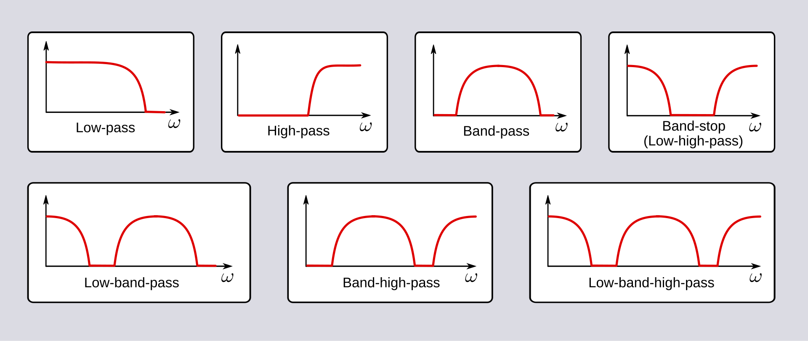
        
Different filter types (Spinningspark, 2009)

    

<h3>Cutoff Frequency</h3>

In the context of a low-pass filter, the cutoff frequency is what determines which frequencies pass the filter (frequencies below the cutoff) and which ones get blocked (frequencies above the cutoff). As a rule of thumb, the cutoff frequency should be ~10 times the maximum frequency of interest for a 2nd order filter and ~5 times for a 3rd or 4th order filter. This is because having a frequency cutoff that is too aggressive will cause the output signal to lose excessive detail.

Every signal can be broken up into a sum of sine waves of different frequencies, phases and amplitudes (known as Fourier series) and the higher frequencies contribute the finer details of the signal. Choosing a cutoff frequency that is near a decade above (in other words, nearly 10 times) the maximum frequency of interest preserves enough detail from the original signal while simultaneously removing undesired noise. Since the designed filter is of the 4th order, and the maximum frequency of interest is conservatively identified as 10 Hz, a 50 Hz cutoff frequency was selected.

    

        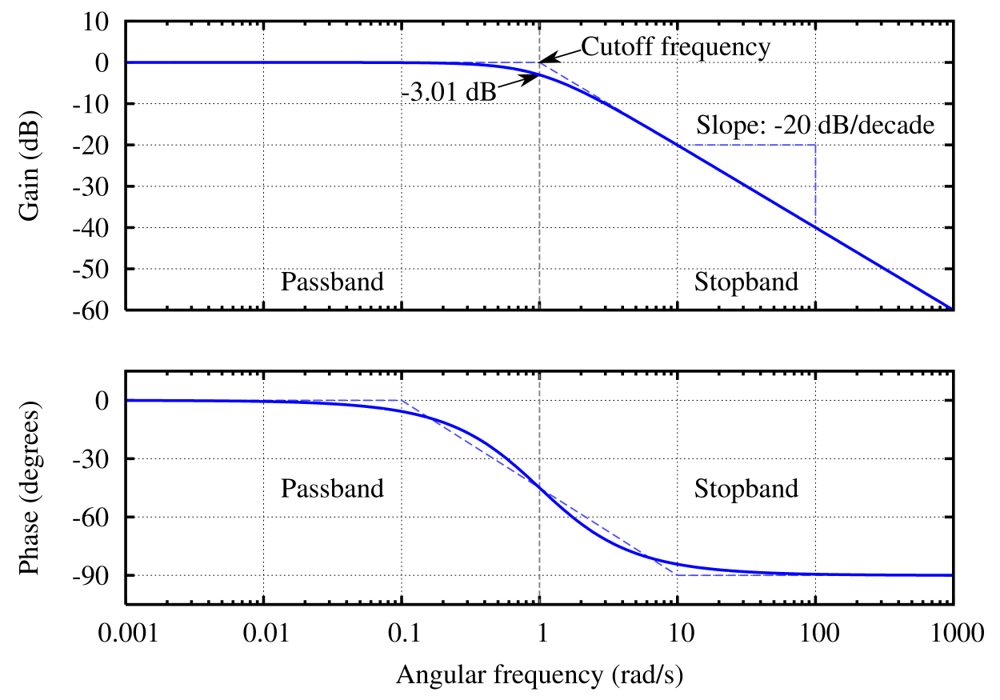
        
Example of a Bode plot for a Butterworth filter (Omegatron, 2005a)

    

    

        <h3>Transfer Functions</h3>
        
It is rather complicated to describe a low-pass filter when we analyse how a signal changes with time. If we were to analyse the circuit in the time domain, we would end up with a differential equation and a solution that probably involves a convolution (a mathematical operation between two functions that involves an integral and is rather difficult to work with in this state). Thankfully, the Laplace transform comes to our rescue! By shifting our perspective from the time domain to the complex frequency domain (picturing the signal as a sum of constant or decaying sine waves), we can (almost magically) forego the convolution for a much simpler multiplication. We only have to multiply the transformed input signal by a function to get the transformed output signal, and that function is called the <strong>transfer function</strong>. Cascading multiple filters together corresponds to multiplying their transfer functions together.

        
The transfer function of a low pass filter takes the form of a fraction with a constant numerator and a polynomial denominator. The filter <strong>order</strong> is the degree of the polynomial. The higher the order, the more complex and detailed the transfer function can be. We can increase the order of our filter by adding more components in stages, each with their own transfer functions multiplying together.

        
One of the most common and useful ways to visualise transfer functions is with a Bode plot. These plots tell you how the function influences the amplitude and phase of the signal for different frequencies. The plot consists of two graphs. For both graphs, the x-axis is the input frequency on a logarithmic scale. One graph&apos;s y-axis is magnitude in dB (a logarithmic scale where 0 is no change [aka unity gain] and an increase of 20 dB corresponds to the magnitude increasing by a factor of 10) and the other is phase shift in degrees.

    

    

        <h3>Response Type</h3>
        
The perfect low-pass filter would perfectly preserve every frequency under 50 Hz and perfectly block every frequency above 50 Hz. Real filters can never achieve this perfection, resulting in frequencies slightly below 50 Hz being slightly attenuated and frequencies slightly above 50 Hz persisting. The approximation of the ideal filter can be improved by increasing the filter order, but there are also different transfer functions we can design, known as response types.

        
There are multiple response types to choose from, each with their own strengths and trade-offs. Some of the most common ones include:

        <ul>
            <li><strong>Butterworth:</strong> The most popular, one-size-fits-all filter with the flattest pass band gain, best if you want to completely eliminate pass band distortion</li>
            <li><strong>Chebyshev (aka type 1 Chebyshev):</strong> Steeper roll-off slope than Butterworth but the pass band is really wavy (ripply)</li>
            <li><strong>Inverse Chebyshev (aka type 2 Chebyshev):</strong> Like the original Chebyshev filter but the ripples are in the stop band instead</li>
            <li><strong>Complete Chebyshev (aka elliptic):</strong> Ripples in both pass and stop band, but sharper roll-off slope than either other Chebyshev filter</li>
            <li><strong>Legendre:</strong> Similar shape to Butterworth. The pass band is not as flat, but the roll-off slope is steeper. Steepest possible cutoff for a monotonic filter (filter where every frequency has a unique gain associated with it)</li>
            <li><strong>Bessel:</strong> The worst roll-off slope of the bunch, but the phase shift is nearly linear, so it is useful for preserving waveforms</li>
        </ul>
        
The Butterworth filter type was chosen because it is the filter type with the most consistent gain level below the cutoff frequency, and it provides a good compromise between roll-off steepness and phase linearity. A Bessel filter has excellent phase linearity but a very slow roll-off that would require a much higher filter order to remedy. The ripples in Chebyshev and Elliptic filters, as well as worse phase linearity, demonstrate that these filter types would impose too many undesired influences on the output signal. In some applications, the slight gain boost for frequencies slightly below the cutoff frequency caused by the ripple in Chebyshev filters could be desirable, but for this application, there is no specific interest in signals near 50 Hz.

    

    

        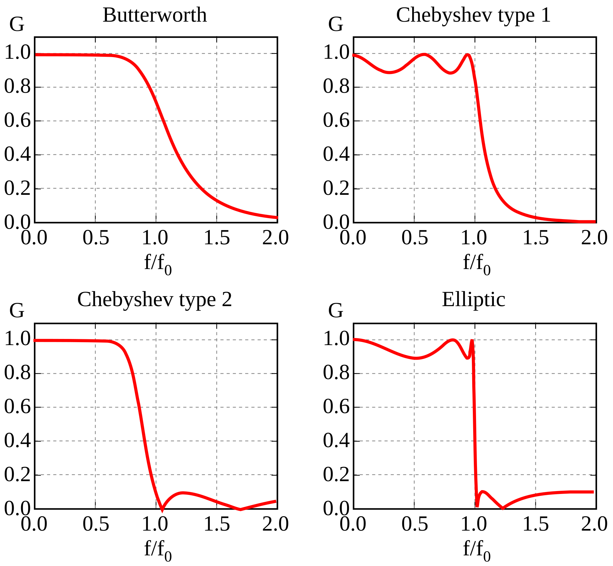
        
Examples of different response types (Geek3, 2016)

    

    

        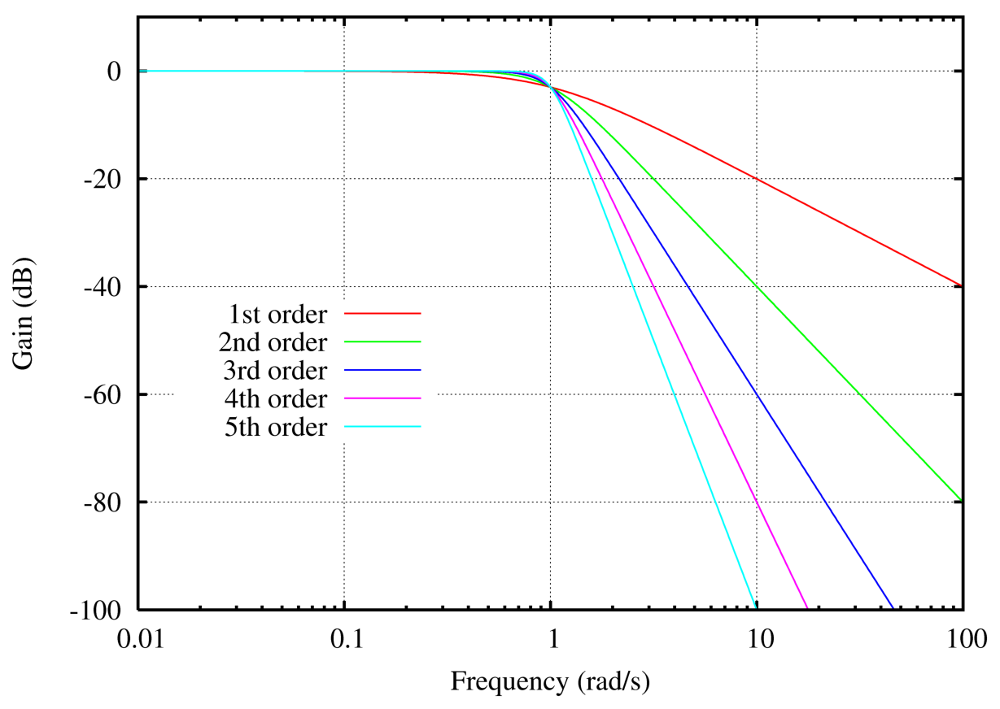
        
Butterworth filter response at different orders (Omegatron, 2005b)

    

    

        <h3>Filter Order</h3>
        
The filter was chosen to have an order of 4. The main reason for this order, instead of 2 or 3, is to remedy the slow roll-off steepness of the Butterworth filter compared to other filter types such as Chebyshev or Elliptical. Another reason to choose this order over a lower one is to improve the compromise between having a high-enough cutoff to preserve signal shape and having a low-enough cutoff to filter out as much high-frequency noise as possible. This is the same compromise that dictates the rule of thumb mentioned earlier. An even-numbered order was selected because odd-numbered ordered filters require an additional first-order filter in the series, making less efficient use of op-amps. A higher filter order was deemed excessive in regards to the increase in the number of required components, PCB space that it would consume, increased soldering time, increased soldering complexity, and an increased number of failure points.

        <h3>Active vs Passive Filtering</h3>
        
In general, an active filter contains only resistors, capacitors and op-amps, and a passive filter contains only resistors, capacitors and inductors. We use active filters because we want to avoid the noise, ripple and weird interference that inductors produce. Passive filters are more useful for high-frequency (eg. radio frequency) high-power applications. Op-amps can only handle frequencies up to a certain point because of their slew rate which dictates how fast their voltage can change.

    

    

        <h3>Filter Topology and Gain</h3>
        
The filter has unity gain for non-attenuated frequencies. This was chosen because the maximum and minimum values of the accelerometer outputs were estimated to range between 0.6 and 2.7 V and the ADC on the MCU is intended to read between 0 and 3.3V. Increasing the gain any further could risk clipping. The device did not require the added detail of gain increase because the 12-bit ADC was already capable of suitably high precision. The stipulation of unity gain reduced the number of necessary components in the filter as well.

        
When it comes to component selection and wiring, there are two main topologies to pick from:

        <ul>
            <li><strong>Multiple Feedback:</strong> Inverting gain filter that is better for high frequencies. If the component values in real life vary greatly compared to their ideal values, this filter is less sensitive to those variations</li>
            <li><strong>Sallen-Key:</strong> Non-inverting gain filter that operates well without noise at unity gain and requires one less resistor</li>
        </ul>
        
The Sallen-Key filter topology was chosen for the implementation of this filter because it facilitates the stipulation of unity gain, has less noise at unity gain and uses less components compared to the multiple feedback topology.

    
 
    

        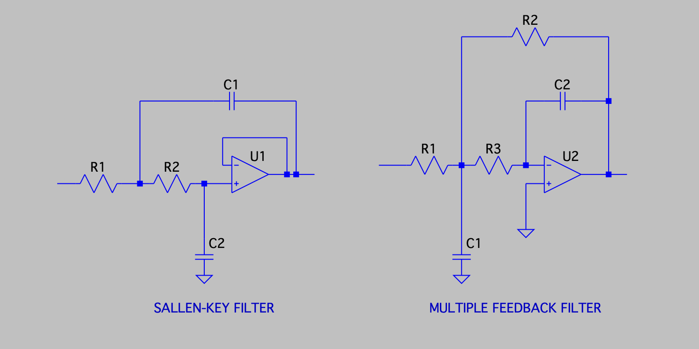
        
Sallen-Key topology vs multiple feedback topology

    

<h3>Component Selection</h3>

The capacitors were chosen to be surface-mount C0G dielectrics with a tolerance of 1% for precision. This choice of capacitor type provides the most consistent performance across a range of temperatures, they do not age as rapidly as other ceramic types, and they are not piezoelectric (so they do not generate voltage due to vibration or stress). 

The resistors were chosen to be surface-mount metal film with low temperature coefficients and a tolerance of 1% for precision. This resistor type will ensure that the cutoff frequency drifts minimally with temperature fluctuations and experience low electric noise. The minimal form factor of SMD components reduces parasitic inductance relative to through-hole components, making the filter performance more predictable.

Test points are placed at the beginning and end of each filter to conduct tests on the filter&apos;s effects on the signal. A U.FL connector is also connected to the output of the filter for the Z axis signal. An adapter is used to make this connector compatible with the BNC cables used for oscilloscope analysis. The choice of a U.FL connector instead of a BNC connector resulted in major space saving for the final PCB and casing designs.

    

        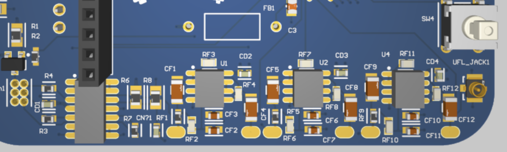
        
Components on the PCB design in Altium Designer

    

    

        
Each filter uses an MCP6002 dual op-amp IC. These op-amps were chosen because:

        <ul>
            <li>They are cost-effective relative to alternatives</li>
            <li>They have a suitable gain-bandwidth product</li>
            <li>They have a suitable slew rate</li>
            <li>The maximum voltage offset is sufficiently low for the application</li>
            <li>The input voltage noise density is sufficiently low for the application</li>
        </ul>
        
A 100 nF decoupling capacitor is used to prevent ripples in the power plane from affecting the op-amps. A C0G dielectric was chosen for stability under voltage, temperature stability and lack of piezoelectric noise.

    

<h3>Calculations</h3>

The 4th order Butterworth filter can be broken up into two 2nd order stages with the following transfer functions:

\\[
\\frac{1}{1+0.765(\\omega s)+(\\omega s)^2},
\\qquad
\\frac{1}{1+1.848(\\omega s)+(\\omega s)^2}
\\]

Each stage has an associated quality factor, basically a measure of its sensitivity. The stages should be sequenced in order of increasing quality factor to reduce noise and prevent clipping.

The transfer function of a Sallen-Key filter (a single stage of the filter) is the following:

\\[
\\frac{1}
{1+C_2(R_1+R_2)s+R_1R_2C_1C_2s^2}
\\]

Our objective is to find the resistor and capacitor values that will make the transfer functions below look like the transfer functions above. Comparing the coefficients of one of the Butterworth transfer functions with the Sallen-Key transfer function, we get a system of two equations with four unknowns. We get the liberty of &quot;arbitrarily&quot; choosing two of them, and then we have to solve for the other two. It is recommended to choose the capacitor values first because resistor values are more granular.

I created <a href="https://www.desmos.com/calculator/zx5nibqftz">a Desmos calculator</a> to automatically calculate resistor values for given capacitor values, as well as displaying the Bode plots for the resulting filter to see how well the Sallen-Key transfer function matches the Butterworth transfer functions. This helped greatly to rapidly iterate and test new capacitor values.

<h3>Simulation</h3>

The circuit was constructed in LTspice. Simulations were run for an AC sweep (to construct a Bode plot), resulting in the response that was anticipated from. I also ran a time-domain simulation to see that a sine wave of about 5 Hz receives virtually no attenuation (but a small phase shift), a sine wave of about 500 Hz is completely attenuated, and a sine wave of about 50 Hz receives an attenuation of -3 dB and phase delay of 180&deg;, as predicted by the transfer function found earlier.

    

        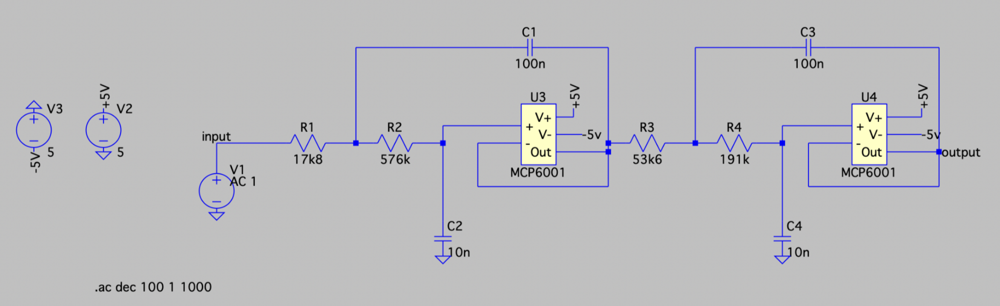
        
Filter schematic modelled in LTspice

    

    

        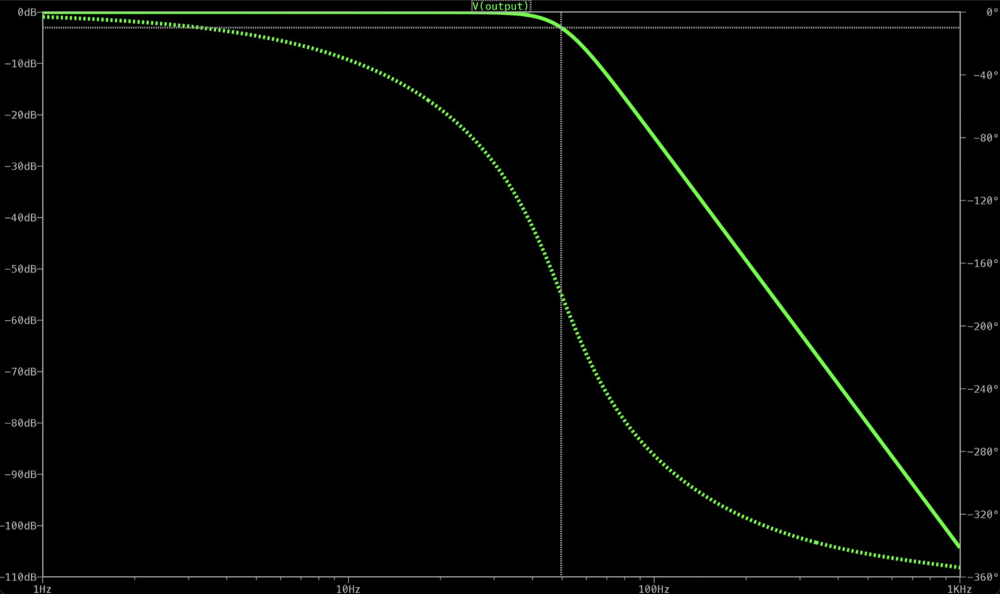
        
Bode plot generated from LTspice simulation

    

    

        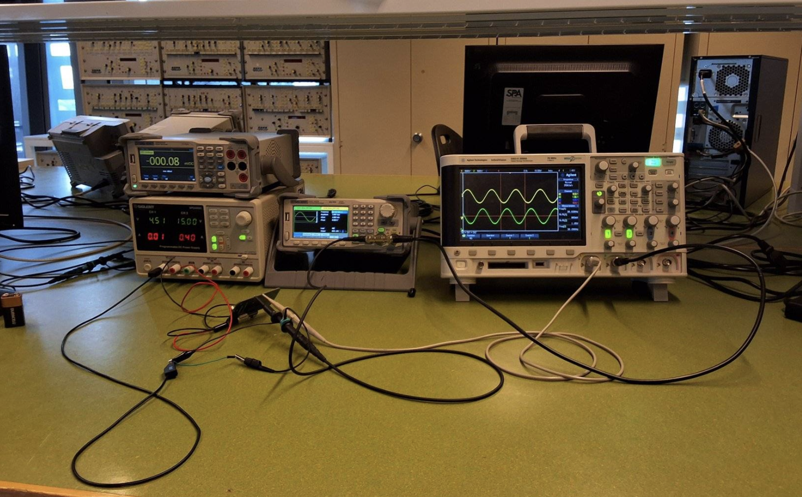
        
Test rig including power supply, function generator and oscilloscope

    

    

        <h3>Testing</h3>
        
The experimental setup for the filter tests utilised the lab power supply to provide a consistent input power with a safe current limit to ensure no components would be destroyed by excessive current. A probe was attached to a filter input which provided an input sine wave generated by a waveform generator. The sine wave had an offset of 1.5 V and an amplitude of 1 Vpp. Another probe was attached to the filter output and measured the voltage on an oscilloscope. The response of each filter was measured by varying the frequency of the sine wave, constructing a Bode plot.

        
For the majority of tested filters on different PCBs, including all of the filters on the PCB that would be used for the final device, the filters exhibited a behaviour that was very close to simulated results, having near unity gain below the cutoff frequency, having a gain of approximately -3 dB at the cutoff frequency and a similar roll-off. However, the inherent precision and noise limitation with the system and given tools prevented the accurate measurement of attenuation above 100 Hz. The measured phase delays also matched up well against simulated results. Some filters did exhibit unpredicted behaviour, such as non-sinusoidal outputs for sinusoidal inputs (a property that a true linear time invariant system should not exhibit) and negative phase delay. After thorough examination of soldering and components, these problems were determined to be faults of op-amps and soldering. They were promptly solved by soldering again.

    

<h2>Algorithms and Programming</h2>

    

        <h3>Calibration</h3>
        
The calibration test aims to determine if each axis of the accelerometer is giving an appropriate signal value for a variety of orientation. It is conducted by holding the device in 6 orientations:

        <ul>
            <li>Up</li>
            <li>Down</li>
            <li>Left</li>
            <li>Right</li>
            <li>Front</li>
            <li>Back</li>
        </ul>
        
For each orientation, the user is given a prompt to properly orient the device. Once the user confirms the correct orientation with a button press, the device waits for one second to ensure stillness. Then, the device samples each accelerometer axis 30 times at 50 Hz. It calculates the means and variances of each axis.

        
The test passes for a single orientation if all of the following criteria were met:

        <ul>
            <li>The variances of each axis is less than 0.07 g2 (to ensure that the device was held steady during the test and that the accelerometer readings are otherwise stable)</li>
            <li>The axis that is aligned with gravity measures an average of 1 g in that direction with a clearance of 0.35 g</li>
            <li>The axes that are not aligned with gravity measure an average of 0 g with a clearance of 0.5 g</li>
        </ul>
        
This test is repeated for each orientation. Calibration is considered successful if the test for each axis passes.

    

    

        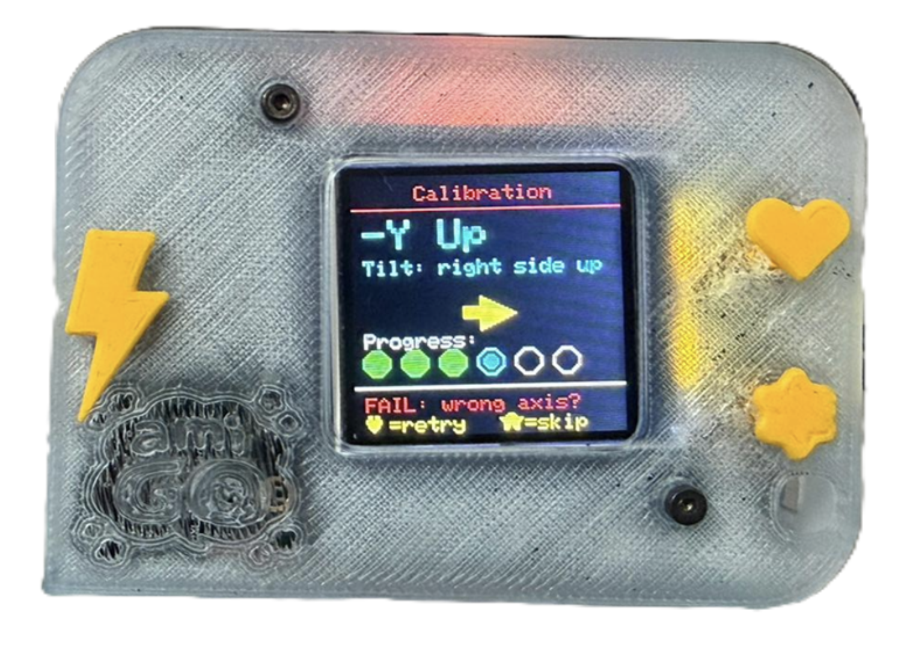
        
Calibration screen running on device

    

    

        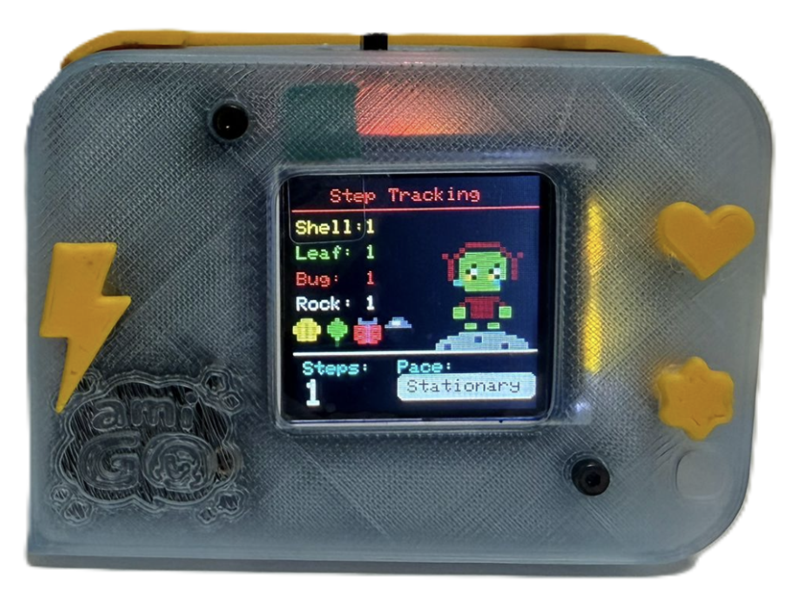
        
Step-tracking and pace identification screen running on device

        

        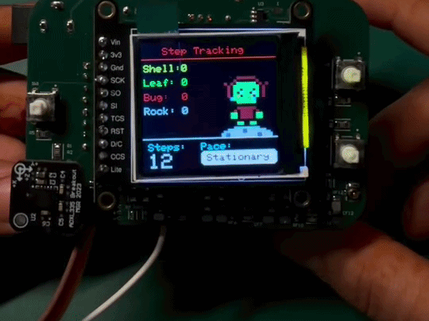
        
Step-tracking and pace identification working

    

    

        <h3>Step Counting</h3>
        
The X, Y and Z axes signals from the accelerometer are read through the ADC at 50 Hz. They are stored in a buffer to be passed through an infinite impulse response filter. It is a 2nd order Butterworth low pass filter with a cutoff frequency of 5 Hz. This has the effect of taking all the motion of interest (which occurs around or under 5 Hz) and turning it into a smooth sine wave.

        
The sampling is broken up into 1.5 second intervals. The maximum and minimum values of each signal (after digital filtering) is calculated during these intervals. When the next interval occurs, these maximum and minimum values are used to calculate a threshold value (the mean of the maximum and minimum, halfway between each) and a range value (the difference between the maximum and minimum). The axis with the largest range becomes the axis that is used for calculating steps in the subsequent interval. The range calculation is also used to determine if there is enough movement in the axis of interest to count as steps.

        
This dynamic threshold approach was adopted from an <a href="https://www.analog.com/en/resources/analog-dialogue/articles/pedometer-design-3-axis-digital-acceler.html">article by Neil Zhao</a> to account for long-term variations in the acceleration profile for walking or running users. The 1.5 second interval was chosen because it is long enough to detect at least one full step, but also short enough to keep the threshold updates sufficiently responsive. The timestamp at which the step took place is recorded in a buffer to be used for pace identification.

        
The system counts a step when:

        <ul>
            <li>the dominant signal crosses below the threshold,</li>
            <li>the range of the previous interval was sufficiently large, and</li>
            <li>at least 250 ms have passed since the last step (to prevent steps from accumulating unrealistically fast)</li>
        </ul>
        
The step counter resets when prompted by the user.

        <h3>Pace Identification</h3>
        
During step counting, a buffer of timestamps for the last 8 steps is kept. This buffer is used to approximately calculate the user&apos;s cadence (how many steps they are taking per minute) by finding the time between the oldest and newest timestamps (the approximate time it takes for the user to take 7 steps). This cadence value helps determine which pace the user is moving at.

        
The transition threshold from walking to running is higher than the threshold from running to walking (145 steps/min vs 130), and similarly between stationary and walking. This hysteresis is implemented to ensure that state transitions occur more smoothly and seamlessly. If the thresholds were the same in both directions, the state machine would exhibit unstable quick switching behaviour if the user maintained a pace that minutely fluctuated around the threshold.

    

    

        <h3>Implementation and Testing</h3>
        
The algorithms were written in C++ and compiled with Arduino IDE (due to its ease of use). The soldered-on MCU (an STM32F303K8) had to be programmed by accessing certain pins with an ST-Link V2 USB peripheral.

        
The testing and validation process undertaken for the embedded software demonstrates comprehensive coverage of all major system functionalities and requirements. Testing was performed across the complete system, including boot-up procedures, user authentication, menu navigation, button inputs, display operation, RFID communication, accelerometer sensing, self-test routines, calibration procedures, step tracking, and pace identification. Each subsystem was independently verified before being tested as part of the integrated system. All tests passed successfully, confirming that the software operates as intended and complies with the specified functional requirements.

        
The code is open source and you can find it <a href="https://github.com/RobotixDan/41070-amiGO-embedded">here</a>!

    

    

        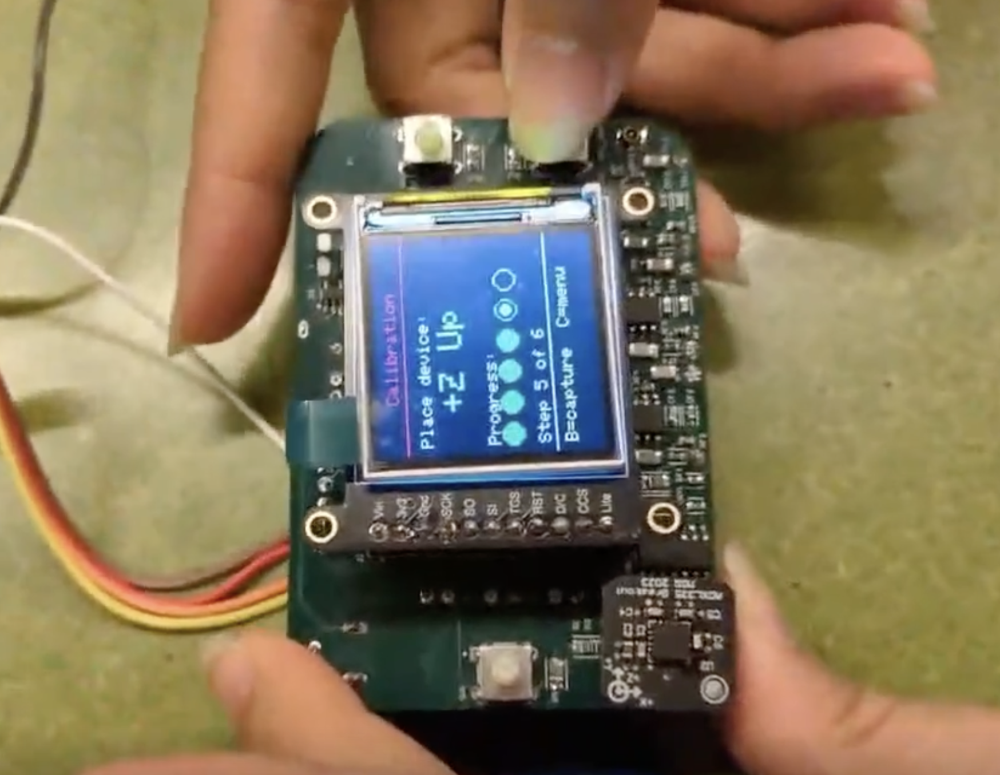
        
Testing calibration

    

<h2>References</h2>

Geek3. (2016). <em>Filters order5</em> [Image]. Wikimedia Commons. https://commons.wikimedia.org/wiki/File:Filters_order5.svg

Karki, J. (2023). <em>Active Low-Pass Filter Design</em>. https://www.ti.com/lit/an/sloa049d/sloa049d.pdf?ts=1786501754072

Omegatron. (2005a). <em>Butterworth filter bode plot</em> [Image]. Wikimedia Commons. https://commons.wikimedia.org/wiki/File:Butterworth_filter_bode_plot.png

Omegatron. (2005b). <em>Butterworth orders</em> [Image]. Wikimedia Commons. https://commons.wikimedia.org/wiki/File:Butterworth_orders.png

Spinningspark. (2009). <em>Filter bandform diagrams</em> [Image]. Wikimedia Commons. https://commons.wikimedia.org/wiki/File:Bandform_template.svg

Zhao, N. (2010). <em>Full-Featured Pedometer Design Realized with 3-Axis Digital Accelerometer</em>. https://www.analog.com/en/resources/analog-dialogue/articles/pedometer-design-3-axis-digital-acceler.html

