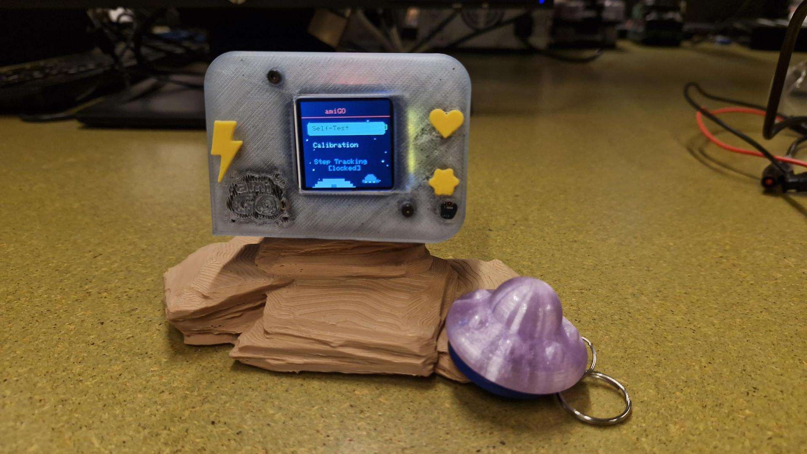
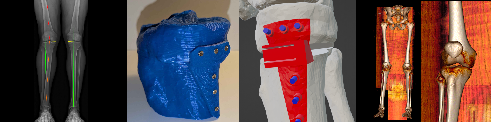
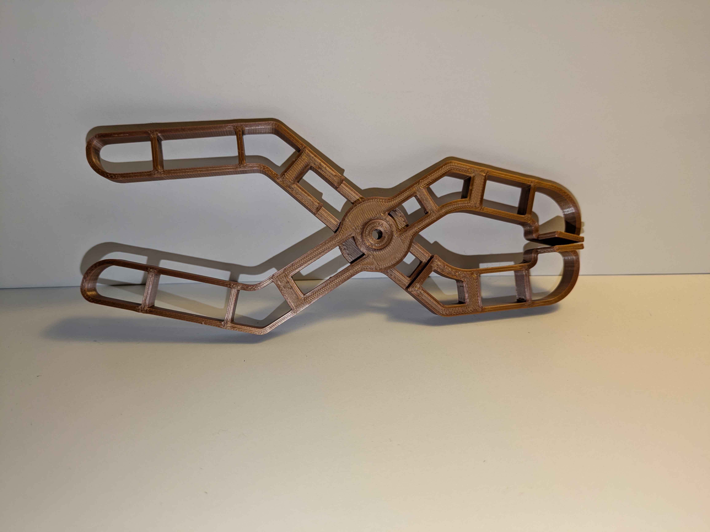

---
# Feel free to add content and custom Front Matter to this file.
# To modify the layout, see https://jekyllrb.com/docs/themes/#overriding-theme-defaults

layout: default
folder: "home"
banner: "ambiguous-banner-1.png"
permalink: "/"
---

<h1 style="text-align: center;">Hi, I'm Chris!</h1>

Thanks for checking out my portfolio!

I'm a fourth-year Mechanical and Mechatronic Engineering student with a passion for programming and 3D printing.

Below are some projects I've worked on (click the cards to learn more):

    <a class="col-md-4 floaty-card" href="{{ '/ami-go/' | relative_url }}">
        

            <h1>Ami-GO Step Tracker</h1>
            
We designed an electronic step-counting device to encourage children and teenagers to go outside and be more active. This was a multi-faceted project involving circuit design, PCB design, embedded programming and the creation of a 3D-printed case. My main contributions to the project were:

            <ul>
                <li>Designing an analog low-pass filter for an accelerometer</li>
                <li>Programs to count steps with the accelerometer signal</li>
            </ul>
            <h2>Skills Used</h2>
            <ul>
                <li>PCB CAD (Altium Designer)</li>
                <li>Circuit analysis and simulation (LTspice)</li>
                <li>Embedded programming (Arduino IDE, C++, STM32CubeProg)</li>
                <li>Circuit testing (oscilloscope, multimeter)</li>
            </ul>
            
        

    </a>
    <a class="col-md-4 floaty-card" href="{{ '/osteotomy-psi/' | relative_url }}">
        

            <h1>Osteotomy PSI</h1>
            
I designed a surgical guide for an osteotomy (a surgery where bone is cut and realigned). This precise 3D-printed object mounts onto the surface of a bone in surgery, helping to guide the surgeons' drills and saws. I also designed a plate to secure the realigned bone so it can heal safely and steadily.

            <h2>Skills Used</h2>
            <ul>
                <li>X-Ray Analysis</li>
                <li>CT Scan Segmentation (Horos)</li>
                <li>CAD (Blender)</li>
                <li>3D Printing</li>
            </ul>
            
        

    </a>
    <a class="col-md-4 floaty-card" href="{{ '/pliers/' | relative_url }}">
        

            <h1>Monolithic Pliers</h1>
            
I designed a pair of 3D-printed pliers that are monolithic (printable in one piece with minimal post-processing). My design weighs under 20 g but can apply over 4 kg of clamping force before breaking.

            <h2>Skills Used</h2>
            <ul>
                <li>CAD (Autodesk Fusion)</li>
                <li>Design for Additive Manufacturing</li>
                <li>Finite Element Analysis</li>
                <li>3D Printing</li>
            </ul>
            
        

    </a>

